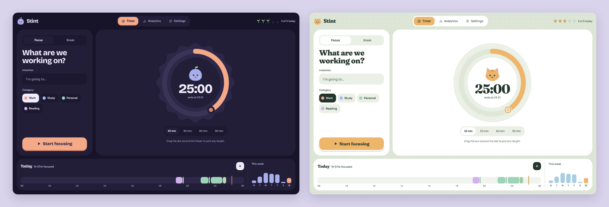

# Stint

A focus timer for Windows that ties every session to what you meant to do, asks how it went, and shows where your day actually went.


**[Live demo](https://rachelmgaldino.github.io/stint/)** (the web build, with sample sessions kept in your browser)

## Overview

I plan my day in focus sessions: say what I'm about to do, run a timer, note how it went, and look back at where the time went. The app I used for this has no Windows version, and my working machine runs Windows, so I built my own as a native desktop app. It keeps the habit I already had and adds a layout and look of its own.

## Features

- Drag a dot around the dial to set any session length, or to change the time left while it runs
- An intention and a category for each session, with a daily goal shown as sprouts
- Sessions and breaks keep counting into overtime until you end them, so stopping is always a choice
- A short reflection afterwards (what got done, how it felt), which can be switched off
- Analytics by day, week and month: a timeline of the day with notes and breaks, focus by category and intention, and change from the previous period
- Two-way link with Google Calendar: each session is written to a calendar you pick, and your calendar's events show beside your sessions
- Updates itself: Settings checks GitHub for a newer version, downloads it and restarts, with a quiet check when it opens
- Two looks (Lavender with Pip, Mochi the cat), each with light, dark and match-Windows themes, in English or Portuguese (Brazil)




## How it works

**A desktop app, not a website.** A focus timer has to keep time while its window is hidden and notify you when it's done. Browsers throttle timers in background tabs, so a web page can be late to tell you a session is over, and it stops entirely once the tab is closed. Stint is a [Tauri 2](https://tauri.app) app: a Rust process owns the window, the tray icon and the alarm, and the interface is React running in the system's WebView. It uses the WebView2 runtime that already ships with Windows instead of bundling a whole browser the way Electron apps do.

**Time comes from the wall clock, not from ticks.** The timer state (`src/timer.ts`) stores when a session started and how long it was paused, and computes what's left from `Date.now()`. A hidden window, a laptop going to sleep or a slow frame can't make it lose time. The "time's up" notification is scheduled in Rust (`src-tauri/src/lib.rs`) in short naps against the wall clock, so a laptop that sleeps through the end still notifies the moment it wakes, even with the window closed to the tray.

**Google sign-in without a server.** Calendar access uses OAuth for installed apps: Stint opens a one-time loopback port on `127.0.0.1`, sends you to Google with a PKCE challenge, and catches the redirect itself (`src-tauri/src/google.rs`). The refresh token goes into Windows Credential Manager, never into the app's database or the interface. The UI asks Rust to make Calendar requests on its behalf and never sees a token, and those requests can only reach Calendar endpoints. Each person supplies their own Google OAuth client, so there's no shared secret in the repository and no third party in the middle.

**Updates that can't be swapped.** Stint updates itself from GitHub Releases with Tauri's updater (`src-tauri/src/updates.rs`). The manual Release workflow signs the installer with a private key kept only in GitHub Actions secrets and publishes a `latest.json` next to it; the app holds the matching public key and refuses any installer whose signature doesn't match. It only looks at the latest published release, so the test builds attached to pull requests are never offered as updates.

**Your data stays on your machine.** Sessions, categories and settings live in a local SQLite file, with the schema in versioned migrations. There's no account and no sync service. Events Stint writes to Google are tagged with a private property, so when it reads your calendar back it skips its own sessions instead of showing them twice.

**One interface, three places.** The same React code runs as the desktop app, as `npm run dev` in a browser (with data in localStorage instead of SQLite), and as the public demo on GitHub Pages. Below 640px it switches to a phone layout with a bottom tab bar and bottom sheets, which is what the demo shows on a phone.

## Tech

- **Desktop shell:** Tauri 2 and Rust (tray, notifications, single instance, signed self-updates, OAuth with `reqwest`, `keyring`, `sha2`)
- **Interface:** React 19 and TypeScript, built with Vite; plain CSS with custom properties for the two looks and their themes
- **Data:** SQLite through `tauri-plugin-sql`
- **Tests:** Vitest for timer, dial, date, analytics and calendar logic; Rust unit tests for PKCE and the OAuth redirect parser
- **CI:** GitHub Actions tests and builds the Windows installer on every push, attaches a test installer to every pull request, publishes a versioned GitHub Release from a manual "Release" workflow that bumps the version, and deploys the web demo to GitHub Pages

## Running it locally

### Prerequisites

- Node.js 22 or newer
- Rust (stable), only for the desktop app
- On Windows, the WebView2 runtime (already present on Windows 10 and 11)

```bash
git clone https://github.com/rachelmgaldino/stint.git
cd stint
npm install
npm run dev           # the interface in a browser, data kept in localStorage
npm run tauri dev     # the desktop app with hot reload
npm test              # unit tests
npm run tauri build   # Windows installer in src-tauri/target/release/bundle
```

To try it without building, download the `.exe` from the [latest release](https://github.com/rachelmgaldino/stint/releases/latest) and run it. It isn't code-signed, so SmartScreen will ask you to confirm. Data lives in `%APPDATA%\com.rachelmgaldino.stint\stint.db` and survives updates.

### Google Calendar

Optional. You need your own OAuth client: in Google Cloud Console, enable the Google Calendar API, set up the consent screen as External and publish it, then create an OAuth client of type **Desktop app**. Paste its client ID and secret into **Settings, Calendar** and click **Connect**. Stint asks only to read your calendar list and manage events; **Disconnect** deletes the stored token and revokes it at Google.

### Updates

Releases are signed so installed copies can update themselves. The Release workflow needs two repository secrets, `TAURI_SIGNING_PRIVATE_KEY` and `TAURI_SIGNING_PRIVATE_KEY_PASSWORD`, and stops before bumping the version if the key is missing. The public half is `plugins.updater.pubkey` in `src-tauri/tauri.conf.json`. A fork needs its own key pair (`npx tauri signer generate`) and its own endpoint.

## What I'd improve

- [ ] No blocking of distracting apps or websites during a session yet. It's the feature I'd add next
- [ ] No global hotkey: Space and the arrow keys only work while the window has focus
- [ ] If a calendar write fails (for example, Google revoked the sign-in), it's only logged. The app should say so and offer to reconnect
- [ ] The installer isn't code-signed, so every new version triggers a SmartScreen warning
- [ ] Windows only. The phone layout exists, but there's no iPhone build yet

AI disclosure: Stint was built with Claude Code. I set the product direction and design, and reviewed, tested and merged every change; Claude drafted much of the implementation.

## Contact

**Rachel Galdino**
- Email: [rachel.galdino@proton.me](mailto:rachel.galdino@proton.me)
- LinkedIn: [linkedin.com/in/rachel-galdino](https://www.linkedin.com/in/rachel-galdino/)
- GitHub: [github.com/rachelmgaldino](https://github.com/rachelmgaldino)
